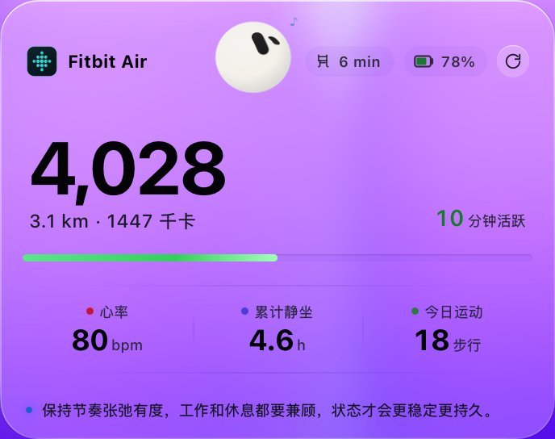

<div align="center">

# Fitbit Air

**macOS 向けの透過リキッドガラス・デスクトップヘルスウィジェット — Google Health API × Tauri 2 × React 18**

[English](README.md) · [简体中文](README.zh-CN.md) · [日本語](README.ja.md) · [한국어](README.ko.md)

[](https://github.com/ARRIIIIIS/google-health-dashboard/releases/tag/v3.1.0)
[-0a84ff?style=flat-square)](#インストール)
[](https://v2.tauri.app/)
[](https://react.dev/)
[](https://www.rust-lang.org/)
[](LICENSE)

<br>



</div>

---

## 概要

**Fitbit Air** は、Dock に表示されずフォーカスも奪わない軽量な macOS デスクトップ常駐ヘルスウィジェットです。macOS ネイティブのすりガラス効果（`NSVisualEffectView`）と `24px` のスーパー楕円 **Liquid Glass** デザインにより、日々の歩数・心拍数・Fitbit バッテリー残量・座りすぎ状態を美しく可視化します。

## 主な機能

- **Liquid Glass デザイン**：`24px` 角丸と macOS ネイティブのすりガラスを採用し、システムのライト／ダークモードに自動追従。
- **リアルタイム健康指標**：歩数（目標 `1,000 〜 50,000` 歩を設定可能）・距離・消費カロリー・アクティブ時間・心拍数（現在／安静時）・HRV・血中酸素・睡眠ステージを表示。
- **Fitbit バッテリー & 同期監視**：`pairedDevices` からバッテリー残量をリアルタイム取得（`25%` 以下で警告色、2 時間以上未同期で通知）。
- **7 日間グロー折れ線グラフ**：歩数または心拍エリアをクリックすると 7 日間の推移と平均比較を展開。グリッドなしのグラデーション透過と週末・欠損データの破線補完に対応。
- **4 種類のデスクパートナー**：**球球 / 雲宝 / 亮亮 / 鉗鉗**（3 分ごとのランダム切替対応）。30fps カーソル視線追従や画面ロック時のゼロ電力スリープを搭載。
- **AI ヘルスアドバイス**：OpenAI 互換 API と連携し、時間帯・座りすぎ・バッテリー・キャラ設定に応じた 30 文字以内の自然な一言を生成（重複回避メモリ付き・クリックで更新）。
- **スマート座りすぎ検知**：歩数変化と macOS キーボード／マウスアイドル検知を組み合わせ、離席中の誤通知を防止。通知時間帯・昼休みミュート（`12:00–13:30`）・平日のみ・集中モード連動に対応。
- **シンプルメニューバー & 3 ステップ設定**：メニューバーは「パートナー／設定…／再起動／終了」のみに整理。ローカルブラウザ上の 3 ステップウィザードで Google OAuth 連携から詳細設定まで完結します。

## インストール

1. [GitHub Releases](https://github.com/ARRIIIIIS/google-health-dashboard/releases/latest) から **`Fitbit.Air_3.1.0_aarch64.dmg`** をダウンロードします。
2. DMG を開き、**`Fitbit Air.app`** を「アプリケーション」フォルダへドラッグします。
3. 起動後、メニューバーアイコン → **設定…** からブラウザの 3 ステップウィザードを開きます：
   - **01 · Google 健康データ**：OAuth Client ID / Secret を入力し、ワンクリック認証と疎通テストを実施。
   - **02 · AI アドバイス** *(任意)*：プロバイダを選択、または任意の OpenAI 互換 Base URL / API Key / モデルを設定。
   - **03 · 設定とスケジュール**：**デスクパートナー**の選択、外観・言語・通知時間帯・目標歩数・ログイン時起動・データフォルダ設定を実施。

## 開発・ビルド

### 動作要件

- **macOS**（Apple Silicon 推奨）
- **Rust ≥ 1.88**（`rustup` stable、`PATH` で `~/.cargo/bin` を優先）
- **Node.js ≥ 20** & **Python 3**（`fetch_standalone.py` 用）

### コマンド

```bash
npm install
npm run tauri dev          # 開発モード
npm run install:mac        # ビルドして /Applications/Fitbit Air.app にインストール
bash ./scripts/build_dmg.sh "/Applications/Fitbit Air.app" "./Fitbit.Air_3.1.0_aarch64.dmg"
```

## プライバシーとセキュリティ

- **100% ローカル完結**：OAuth トークン・API キー・健康データはすべて端末内（`~/.google-health-mcp/` および Tauri `app_data_dir`）にのみ保存され、外部送信やテレメトリはありません。
- **CSRF 対策**：ローカル設定サーバー（`127.0.0.1`）はプロセス単位の `X-Setup-Token` 検証を必須としています。

## License

[MIT](LICENSE) © [ARRIIIIIS](https://github.com/ARRIIIIIS)
