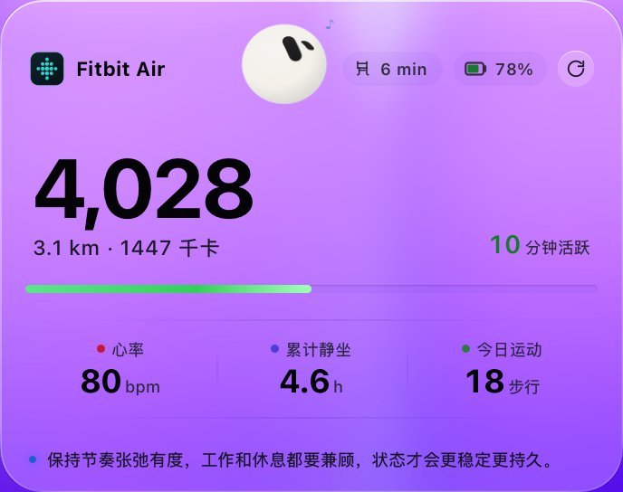

<div align="center">

# Fitbit Air

**macOS용 리퀴드 글래스 데스크톱 헬스 위젯 — Google Health API × Tauri 2 × React 18**

[English](README.md) · [简体中文](README.zh-CN.md) · [日本語](README.ja.md) · [한국어](README.ko.md)

[](https://github.com/ARRIIIIIS/google-health-dashboard/releases/tag/v3.1.0)
[-0a84ff?style=flat-square)](#설치-방법)
[](https://v2.tauri.app/)
[](https://react.dev/)
[](https://www.rust-lang.org/)
[](LICENSE)

<br>



</div>

---

## 소개

**Fitbit Air**는 Dock에 나타나지 않고 창 포커스도 빼앗지 않는 가볍고 투명한 macOS 데스크톱 헬스 위젯입니다. macOS 네이티브 블러(`NSVisualEffectView`)와 `24px` 슈퍼 엘립스 **Liquid Glass** 디자인으로 걸음 수, 심박수, Fitbit 배터리 잔량, 착석 시간을 바탕화면 한쪽에서 깔끔하게 확인할 수 있습니다.

## 주요 기능

- **Liquid Glass 디자인**: `24px` 라운드와 macOS 네이티브 반투명 효과를 적용해 시스템 라이트/다크 모드에 자동 대응합니다.
- **실시간 건강 지표**: 걸음 수(`1,000 ~ 50,000` 목표 설정), 거리, 칼로리, 활동 시간, 실시간/안정 시 심박수, HRV, 혈중 산소 및 수면 단계를 표시합니다.
- **Fitbit 배터리 & 동기화 상태**: `pairedDevices`에서 배터리 잔량을 실시간으로 읽어 상단 바에 표시합니다(`25%` 이하 경고, 2시간 이상 미동기화 알림).
- **7일 그라데이션 글로우 추세선**: 걸음 수 또는 심박 영역을 클릭하면 7일 추세 및 평균 대비 차이를 펼쳐 보여줍니다.
- **4종의 데스크톱 컴패니언**: **Qiuqiu / Nimbo / Twinkle / Claw** (3분 자동 순환 지원) — 마우스 커서 시선 추적과 화면 잠금 시 제로 전력 절전 모드를 지원합니다.
- **AI 맞춤 건강 조언**: OpenAI 호환 API를 연동해 시간대, 착석 시간, 배터리, 캐릭터 성격에 맞는 짧은 조언을 생성합니다(클릭 시 즉시 새로고침).
- **스마트 착석 감지**: 걸음 변화와 macOS 입력 유휴/화면 잠금을 함께 감지해 자리 비움 시 오작동을 방지하며, 알림 시간대·점심시간 무음(`12:00–13:30`)·평일 전용·집중 모드 연동을 지원합니다.
- **간결한 메뉴 바 & 3단계 설정 마법사**: 메뉴 바는 핵심 항목만 남기고, 로컬 브라우저의 3단계 마법사에서 Google OAuth 인증과 모든 환경설정을 관리합니다.

## 설치 방법

1. [GitHub Releases](https://github.com/ARRIIIIIS/google-health-dashboard/releases/latest)에서 **`Fitbit.Air_3.1.0_aarch64.dmg`**를 다운로드합니다.
2. DMG를 열고 **`Fitbit Air.app`**을 **응용 프로그램(Applications)** 폴더로 드래그합니다.
3. 앱 실행 후 메뉴 바 아이콘 → **설정…**에서 3단계 브라우저 마법사를 완료하세요:
   - **01 · Google 헬스 데이터**: OAuth Client ID / Secret 입력 및 원클릭 인증, 지연 시간 테스트
   - **02 · AI 건강 조언** *(선택)*: OpenAI 호환 Base URL, API Key, 모델 설정
   - **03 · 환경설정 및 일정**: **데스크톱 컴패니언** 선택, 테마, 언어, 알림 시간대, 목표 걸음 수, 로그인 시 자동 실행 설정

## 개발 및 빌드

```bash
npm install
npm run tauri dev          # 개발 모드 실행
npm run install:mac        # 빌드 후 /Applications/Fitbit Air.app 설치
bash ./scripts/build_dmg.sh "/Applications/Fitbit Air.app" "./Fitbit.Air_3.1.0_aarch64.dmg"
```

> 요구 사항: Rust ≥ 1.88 (`~/.cargo/bin` 우선), Node.js ≥ 20, Python 3

## 개인정보 보호 및 보안

- **100% 로컬 저장**: 모든 OAuth 토큰, API 키, 건강 데이터는 사용자 기기(`~/.google-health-mcp/` 및 Tauri `app_data_dir`)에만 저장되며 외부로 전송되지 않습니다.
- **CSRF 방지**: 로컬 설정 서버(`127.0.0.1`)는 프로세스별 `X-Setup-Token`을 검증합니다.

## License

[MIT](LICENSE) © [ARRIIIIIS](https://github.com/ARRIIIIIS)
