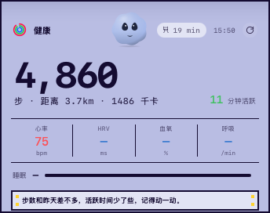

# Fitbit Air

macOS 桌面健康小组件：从 Google Health API 实时同步步数、心率、睡眠与手环电量，常驻屏幕角落。基于 **Tauri 2 + React 18** 构建，透明无边框、不进 Dock、不抢焦点，专注极致通透的 **Liquid Glass（液态玻璃）** 桌面体验。


-blue)


## 视觉设计

纯粹的 **Liquid Glass（液态玻璃）** 风格：`24px` 圆角 + macOS 原生系统磨砂（`NSVisualEffectView`），自动跟随系统深浅色切换：

<p align="center">
  
  &nbsp;&nbsp;
  
</p>

## 核心功能

- **四大核心指标**：步数 / 距离 / 卡路里 / 活跃分钟，支持自定义每日步数目标（`1,000 ~ 50,000` 步），达标亮起 `★` 勋章并触发伙伴庆祝动画
- **生理与睡眠监测**：实时心率 / 静息心率 / HRV / 血氧 / 呼吸率，以及深睡 / 浅睡 / REM / 清醒四段睡眠胶囊条
- **手环电量与同步状态**：从 `pairedDevices` 实时读取 Fitbit 手环电池百分比（`≤25%` 低电量自动琥珀色高亮，超过 2 小时未同步自动提示）
- **7 日渐变发光折线图**：点击步数或心率区即可展开近 7 日趋势与均值对比，采用无网格细线 + 底部透明度渐隐 + 周末/缺省数据虚线衔接，支持点击日期/星期切换
- **四位桌搭伙伴**：**球球 / 云宝 / 亮亮 / 钳钳**（支持每 3 分钟随机轮换），呼吸、眨眼、鼠标光标跟随（30fps 节流 + 320px 休眠）；**Mac 锁屏或隐藏时自动冻结动画与后台采集，零耗电**
- **AI 个性化健康建议**：接入任意 OpenAI 兼容 API，结合当前时段、久坐状态、手环电量与伙伴人设生成 30 字以内口语化提醒（内置最近 6 条去重记忆，点击底部提示语立即换一句）
- **智能久坐检测**：结合步数变化与 macOS 键鼠空闲/锁屏感知（离座不误报、回座自动重置），支持自定义生效时段、午休免打扰（`12:00–13:30`）、仅工作日提醒与跟随系统勿扰
- **精简菜单栏**：仅保留 **桌搭伙伴**、**设置向导与偏好…**、**重启**、**退出** 四项高频入口，所有低频配置收口到设置向导
- **高定 3 步设置向导**：内置本地安全服务（带进程级 `X-Setup-Token` 防跨站保护），支持 Google OAuth 2.0 浏览器一键授权、LLM 延迟测试与全套偏好热更新

## 安装

从 [Releases](https://github.com/ARRIIIIIS/google-health-dashboard/releases) 下载最新的 `Fitbit.Air_3.1.0_aarch64.dmg`，打开后将 `Fitbit Air.app` 拖入「应用程序」即可。

首次启动后通过菜单栏图标 → **设置向导与偏好…** 在浏览器打开 3 步引导页（支持中 / EN / 日切换，所有凭据仅保存在本机）：

1. **Google 健康数据**：填入 OAuth Client ID / Secret → 一键授权 → 测试延迟 → **保存并下一步**（凭据保存在 `~/.google-health-mcp/`）
2. **AI 健康建议**：选择服务商或自定义 Base URL / API Key / 模型名 → 测试延迟 → **保存并下一步**
3. **偏好与作息**：可视化选择 **桌搭伙伴**（球球 / 云宝 / 亮亮 / 钳钳 / 随机轮换），配置外观主题、界面语言、久坐阈值与生效时段、午休免打扰、仅工作日提醒、跟随系统勿扰、步数目标、开机自启，以及一键打开本地数据目录 → **保存并完成**

## 本地开发与构建

```bash
# 安装前端依赖
npm install

# 开发模式（Vite + Tauri 窗口）
npm run tauri dev

# 一键编译并唯一安装到 /Applications/Fitbit Air.app（自动清理旧进程与副本）
npm run install:mac

# 打包带安装画面的 DMG（需先构建好 .app）
bash ./scripts/build_dmg.sh "/Applications/Fitbit Air.app" "./Fitbit.Air_3.1.0_aarch64.dmg"
```

> **环境要求**：
> - Rust ≥ 1.88（`rustup stable`，需确保 `~/.cargo/bin` 在 PATH 前部）
> - Node.js（推荐 v20+ / v26）
> - 本机 Python 3 环境（用于 `fetch_standalone.py` 数据采集）

## 项目结构

```
health-dashboard-tauri/
├── assets/                   # 主题截图与 DMG 安装画面资产
├── scripts/
│   ├── install_app.sh        # 一键编译、清理残留并安装到 /Applications/Fitbit Air.app
│   ├── build_dmg.sh          # 生成带自定义背景与固定图标布局的 .dmg
│   └── patch_dsstore.py      # 校验并钉死 DMG Finder 布局坐标
├── src/                      # 前端（React 18 + Vite）
│   ├── App.jsx               # 主小组件：液态玻璃 UI、7日趋势折线图、伙伴 iframe、gaze 跟随
│   ├── SedPopover.jsx        # 久坐提醒菜单栏弹窗
│   ├── main.jsx              # React 入口
│   ├── styles.css            # 样式与动画
│   ├── i18n.js               # 三语言词条
│   └── mood-mates/ & claw/   # 桌搭伙伴渲染引擎与素材
├── src-tauri/                # Tauri 后端（Rust）
│   ├── src/main.rs           # 窗口管理、TrayIcon 菜单、本地设置向导 HTTP 服务、采集调度
│   ├── resources/
│   │   ├── fetch_standalone.py  # Google Health 采集脚本
│   │   └── setup.html           # 3 步式设置向导页
│   ├── tauri.conf.json       # 应用与窗口配置
│   └── Cargo.toml
└── native-widget/            # 原生 macOS WidgetKit 组件工程（可选）
```

## License

MIT © [ARRIIIIIS](https://github.com/ARRIIIIIS)
