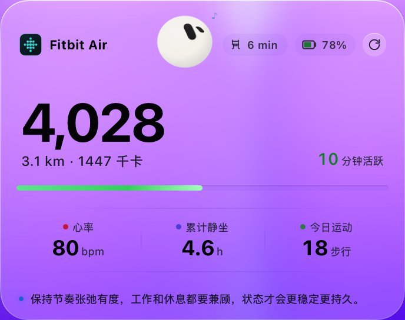

# Fitbit Air

macOS 桌面健康小组件：从 Google Health API 实时同步步数、心率、睡眠与手环电量，常驻桌面角落。基于 **Tauri 2 + React 18** 构建，透明无边框、不进 Dock、不抢焦点，采用 **Liquid Glass（液态玻璃）** 设计。


-blue)


<p align="center">
  
</p>

## 核心特性

- **液态玻璃小组件**：`24px` 圆角 + macOS 原生系统磨砂（`NSVisualEffectView`），自动跟随系统深浅色切换
- **核心健康指标**：步数（自定义每日目标 `1,000 ~ 50,000`）、距离、卡路里、活跃分钟、实时/静息心率、累计静坐与今日运动
- **手环电量与同步感知**：顶栏并排显示久坐计时与 Fitbit 手环电量（`≤25%` 低电量琥珀色高亮，超 2 小时未同步提示）
- **7 日渐变发光折线图**：点击步数或心率区原地展开近 7 日趋势与均值对比，支持点击切换日期/星期与周末虚线衔接
- **四位桌搭伙伴**：**球球 / 云宝 / 亮亮 / 钳钳**（支持每 3 分钟随机轮换），支持鼠标跟随与锁屏零耗电休眠
- **AI 健康建议**：支持任意 OpenAI 兼容 API，结合时段、久坐、手环电量与伙伴人设生成 30 字以内口语化叮嘱（点击即换）
- **智能久坐提醒**：结合步数变化与 macOS 键鼠空闲/锁屏感知，支持自定义生效时段、午休免打扰（`12:00–13:30`）、仅工作日提醒与跟随系统勿扰
- **精简菜单栏 + 3 步设置向导**：菜单栏仅保留「桌搭伙伴 / 设置向导与偏好… / 重启 / 退出」；高定 3 步向导内置 Google OAuth 一键授权、LLM 延迟测试与全套偏好热更新

## 安装

前往 [Releases](https://github.com/ARRIIIIIS/google-health-dashboard/releases) 下载 `Fitbit.Air_3.1.0_aarch64.dmg`，拖入「应用程序」即可。

首次启动后点击菜单栏图标 → **设置向导与偏好…**，按 3 步完成配置（所有凭据仅保存在本机）：

1. **Google 健康数据**：填写 Client ID / Secret → 一键授权 → 测试延迟 → **保存并下一步**
2. **AI 健康建议**：选择服务商或自定义 OpenAI 兼容接口 → 测试延迟 → **保存并下一步**
3. **偏好与作息**：可视化选择 **桌搭伙伴**，配置主题、语言、久坐作息、步数目标、开机自启与本地数据目录 → **保存并完成**

## 开发与构建

```bash
npm install
npm run tauri dev          # 开发调试
npm run install:mac        # 一键编译并安装到 /Applications/Fitbit Air.app
```

> 依赖环境：Rust ≥ 1.88（`~/.cargo/bin` 需在 PATH 前部）、Node.js 20+、macOS Python 3。

## 目录结构

```
├── assets/
│   ├── preview.jpg        # 小组件实机截图
│   └── dmg/               # DMG 安装画面背景与 Finder 布局
├── scripts/
│   ├── install_app.sh     # 编译并安装到 /Applications/Fitbit Air.app
│   └── build_dmg.sh       # 打包带安装画面的 .dmg
├── src/                   # React 18 前端（小组件 UI、7日趋势图、桌搭伙伴引擎）
├── src-tauri/             # Tauri 2 Rust 后端（菜单栏、本地向导服务、采集调度）
└── tests/                 # 采集脚本回归测试
```

## License

MIT © [ARRIIIIIS](https://github.com/ARRIIIIIS)
