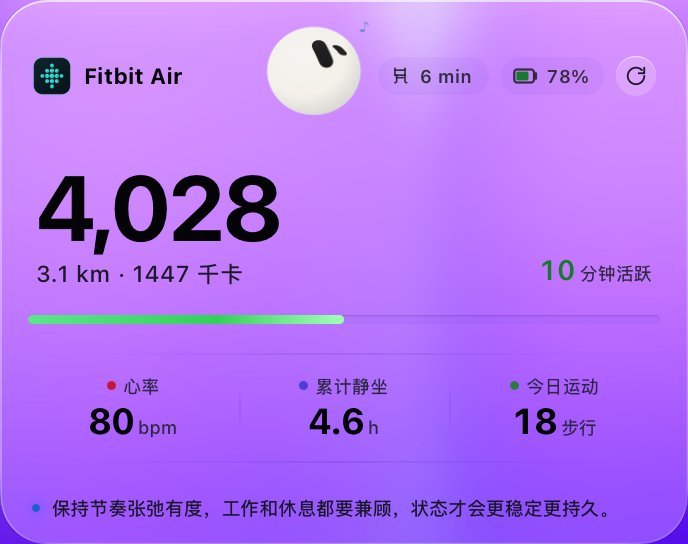

<div align="center">

# Fitbit Air

**极简通透的 macOS 液态玻璃桌面健康小组件 — 基于 Google Health API、Tauri 2 与 React 18 构建。**

[English](README.md) · [简体中文](README.zh-CN.md) · [日本語](README.ja.md) · [한국어](README.ko.md)

[](https://github.com/ARRIIIIIS/google-health-dashboard/releases/tag/v3.1.0)
[-0a84ff?style=flat-square)](#安装使用)
[](https://v2.tauri.app/)
[](https://react.dev/)
[](https://www.rust-lang.org/)
[](LICENSE)

<br>



</div>

---

## 简介

**Fitbit Air** 是一款轻量、透明无边框的 macOS 桌面健康小组件。不进 Dock、不抢焦点，借助 macOS 原生系统磨砂（`NSVisualEffectView`）与 `24px` 超椭圆 **Liquid Glass（液态玻璃）** 质感，将每日步数、心率、手环电量与久坐状态安静地呈现在桌面角落。

## 核心特性

- **纯净液态玻璃**：`24px` 圆角 + macOS 原生磨砂背景，自动跟随系统深浅色切换。
- **全面健康指标**：步数（支持 `1,000 ~ 50,000` 自定义目标）、距离、卡路里、活跃分钟、实时/静息心率、HRV、血氧及睡眠阶段分布。
- **手环电量与同步感知**：顶栏并排展示久坐计时与 Fitbit 手环电量（`≤25%` 琥珀色低电提醒，超过 2 小时未同步自动提示）。
- **7 日渐变发光折线图**：点击步数或心率区原地展开近 7 日趋势与均值对比，支持无网格底部渐隐、周末/缺省虚线衔接与日期/星期点击切换。
- **四位桌搭伙伴**：**球球 / 云宝 / 亮亮 / 钳钳**（支持每 3 分钟随机轮换），支持 30fps 光标视线跟随；Mac 锁屏或隐藏时自动冻结动画与后台采集，零耗电。
- **AI 个性化健康建议**：接入任意 OpenAI 兼容 API，结合时段、久坐、手环电量与伙伴人设生成 30 字以内口语化叮嘱（内置 6 条去重记忆，点击即换）。
- **智能久坐检测**：结合步数变化与 macOS 键鼠空闲/锁屏感知（离座不误报、回座自动重置），支持自定义提醒时段、午休免打扰（`12:00–13:30`）、仅工作日提醒与系统勿扰同步。
- **精简菜单栏 + 3 步设置向导**：菜单栏仅保留「桌搭伙伴 / 设置向导与偏好… / 重启 / 退出」；本地 3 步向导支持 Google OAuth 一键授权、LLM 延迟测试与全套偏好热更新。

## 安装使用

1. 前往 [GitHub Releases](https://github.com/ARRIIIIIS/google-health-dashboard/releases/latest) 下载 **`Fitbit.Air_3.1.0_aarch64.dmg`**。
2. 打开 DMG 后将 **`Fitbit Air.app`** 拖入「应用程序」。
3. 启动后点击菜单栏图标 → **设置向导与偏好…**，按 3 步完成配置：
   - **01 · Google 健康数据**：填入 OAuth Client ID / Secret，点击一键授权并测试延迟。
   - **02 · AI 健康建议** *(可选)*：选择预设服务商或自定义 OpenAI 兼容 Base URL、API Key 与模型。
   - **03 · 偏好与作息**：可视化选择 **桌搭伙伴**，配置外观、语言、久坐作息、步数目标、开机自启与本地数据目录。

## 本地开发与构建

### 环境要求

- **macOS**（推荐 Apple Silicon）
- **Rust ≥ 1.88**（`rustup` stable，需保证 `~/.cargo/bin` 在 `PATH` 中优先于 Homebrew）
- **Node.js ≥ 20** & **Python 3**（用于 `fetch_standalone.py` 数据采集）

### 常用命令

```bash
# 安装前端依赖
npm install

# 开发模式（Vite + Tauri）
npm run tauri dev

# 一键编译并唯一安装到 /Applications/Fitbit Air.app
npm run install:mac

# 打包带安装画面的 .dmg（需先构建 .app）
bash ./scripts/build_dmg.sh "/Applications/Fitbit Air.app" "./Fitbit.Air_3.1.0_aarch64.dmg"
```

## 目录结构

```text
├── assets/
│   ├── preview.jpg          # 小组件实机截图
│   └── dmg/                 # DMG 安装画面背景与 Finder 布局资产
├── scripts/
│   ├── install_app.sh       # 编译并安装到 /Applications/Fitbit Air.app
│   ├── build_dmg.sh         # 生成带自定义背景与固定图标布局的 .dmg
│   └── patch_dsstore.py     # 校验并钉死 Finder .DS_Store 窗口坐标
├── src/                     # React 18 + Vite 前端
│   ├── App.jsx              # 液态玻璃小组件、7日趋势图、伙伴容器
│   ├── SedPopover.jsx       # 久坐提醒菜单栏弹窗
│   ├── i18n.js              # 三语言词条（zh / en / ja）
│   └── mood-mates/ & claw/  # 桌搭伙伴渲染引擎与 SVG 素材
├── src-tauri/               # Tauri 2 Rust 后端
│   ├── src/main.rs          # 窗口管理、托盘菜单、本地向导服务、采集调度
│   ├── resources/
│   │   ├── fetch_standalone.py  # Google Health 数据采集脚本
│   │   └── setup.html           # 3 步式本地设置向导
│   ├── tauri.conf.json      # Tauri 窗口与打包配置
│   └── Cargo.toml
└── tests/                   # 采集脚本回归测试
```

## 隐私与安全

- **100% 本地优先**：所有 OAuth 令牌、API Key 与健康数据仅保存在本机（`~/.google-health-mcp/` 与 Tauri `app_data_dir`），无任何第三方统计或遥测。
- **防跨站保护**：本地设置向导服务（`127.0.0.1`）在所有敏感接口上强制校验进程级 `X-Setup-Token`。

## License

[MIT](LICENSE) © [ARRIIIIIS](https://github.com/ARRIIIIIS)
